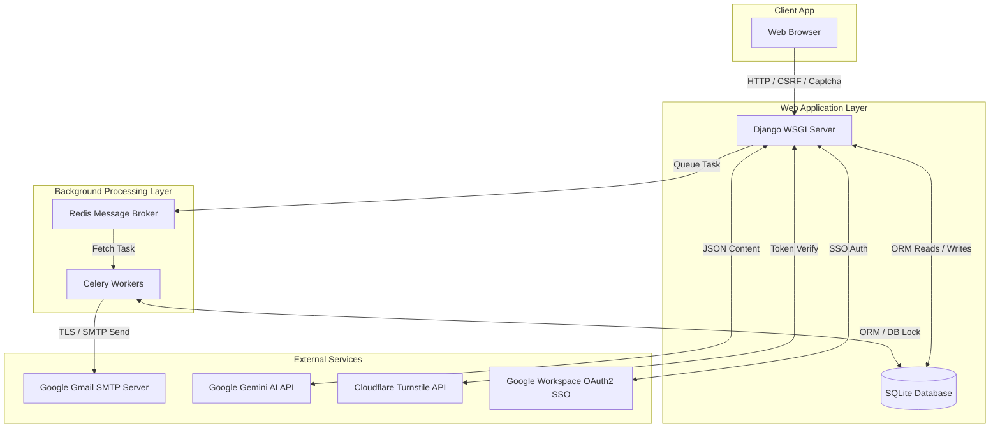
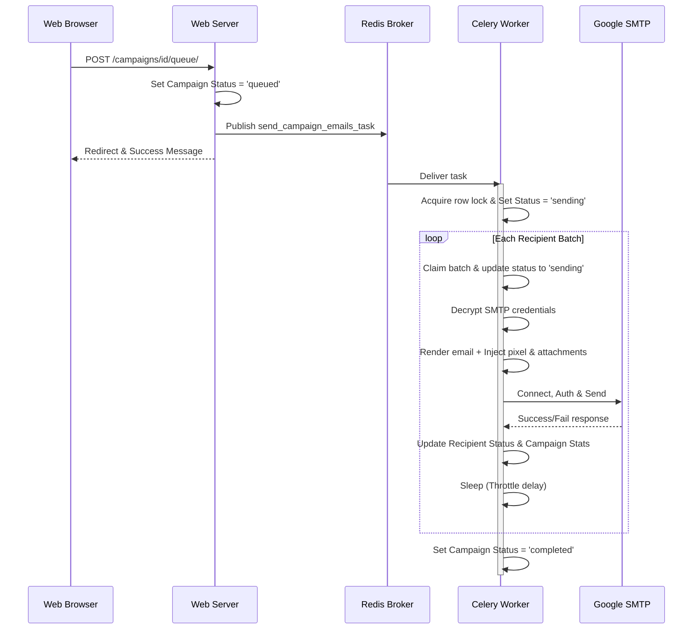

# System Architecture

This document describes the high-level architecture of **EmailOPS**, explaining how its components interact, the data flow, and key design decisions.

---

## High-Level System Overview

EmailOPS is built on a decoupled, asynchronous architecture using Django, Celery, and Redis to ensure that long-running operations—such as bulk email dispatching and image/PDF rendering—do not block the user-facing web server.

---

## Architectural Components

### 1. Web Application Server (Django)
- **Role**: Serves the user interface, manages authentication, processes file uploads, and coordinates tasks.
- **Entrypoints**:
  - [wsgi.py](file:///C:/Users/ASUS/Desktop/WorkTree/EmailOPS/core/wsgi.py) / [asgi.py](file:///C:/Users/ASUS/Desktop/WorkTree/EmailOPS/core/asgi.py) map incoming HTTP requests.
  - Custom error views in [views.py](file:///C:/Users/ASUS/Desktop/WorkTree/EmailOPS/core/views.py) handle bad requests (`400`), unauthorized access (`403`), not found (`404`), and server errors (`500`).
- **Data Access**: Performs reads and writes on the SQLite database using Django's ORM.

### 2. Message Broker (Redis)
- **Role**: Acts as the Celery message broker.
- **Configuration**: Set via `CELERY_BROKER_URL` (typically `redis://127.0.0.1:6379/0`).

### 3. Background Processing Workers (Celery)
- **Role**: Executes CPU-bound tasks (generating certificates with Pillow) and I/O-bound tasks (sending bulk emails via SMTP) asynchronously.
- **Configuration**: Defined in [celery.py](file:///C:/Users/ASUS/Desktop/WorkTree/EmailOPS/core/celery.py).
- **Storage**: Results are logged back to the SQLite database via the `django-db` results backend, configured through `django_celery_results`.
- **Eager mode**: During testing, Celery tasks run synchronously (`CELERY_TASK_ALWAYS_EAGER = True`).

### 4. Database (SQLite)
- **Role**: Relational storage for users, campaigns, templates, credentials, and task execution outcomes.
- **Design Decision**: Local database, simple to configure and manage for self-contained, single-host installations. PostgreSQL can be substituted in production environments to support concurrency guarantees (e.g. `select_for_update` row locks).

---

## Core Data Flows

### A. Bulk Email Sending Workflow
1. **Queue Request**: The user initiates a campaign from [views.py](file:///C:/Users/ASUS/Desktop/WorkTree/EmailOPS/emails/views.py#L183) by clicking **Start Sending**.
2. **Database State Change**: The campaign state transitions from `draft` to `queued`.
3. **Queue Task**: Django calls `send_campaign_emails_task.delay(campaign_id)` to queue the job in Redis.
4. **Celery Lock**: The worker claims the campaign, changing its status to `sending`. On PostgreSQL, a row lock is acquired using `select_for_update()` to prevent concurrent workers from claiming the same batch.
5. **Throttled Batch Sending**: The worker fetches pending recipients, decrypts the SMTP credentials using `cryptography.fernet`, opens a connection, renders templates, sends emails, and sleeps for `throttle_delay` seconds (typically `1.5`s) between sends.
6. **Completion**: Once all recipients are processed, the campaign status changes to `completed`.

### B. Certificate Generation Workflow
1. **Trigger**: If `is_certificate_campaign` is active, the view calls `generate_certificates_task.delay()`.
2. **Worker Rendering**: For each recipient, the worker loads the template background image and custom font file (if provided) using Pillow.
3. **Coordinate Math**: Participant names are dynamically centered inside bounding boxes configured on the template. Text is scaled down if it overflows.
4. **Save PDF**: Generated certificates are exported as PDF bytes and saved to the recipient's `certificate_file` field.
5. **Auto-send Hand-off**: If `auto_send=True`, the worker updates the campaign status to `queued` and spawns `send_campaign_emails_task`.

---

## Strategic Trade-offs & Decisions

### Symmetric App Password Encryption vs. External Key Management
- **Implementation**: App passwords are encrypted with `cryptography.fernet.Fernet` and stored in the database. The decryption key (`SMTP_ENCRYPTION_KEY`) is stored as an environment variable.
- **Trade-off**: Simpler setup compared to using Vault services, but requires securing the server's environment configurations. If the database is compromised, passwords cannot be decrypted without the environment key.

### Local SQLite vs. Client-Server Databases
- **Implementation**: The system uses SQLite (`db.sqlite3`).
- **Trade-off**: SQLite is highly portable, zero-configuration, and fast for reads. However, SQLite lacks robust support for row-level locks (`select_for_update`), causing concurrency guardrails to degrade in local development. For scaled production workloads, migrating to PostgreSQL is recommended.

### Periodic Reaper vs. Strict Real-Time Tracking
- **Implementation**: The background task runner incorporates a reaper (`reap_stale_sending_recipients_task`) that periodically resets recipients stuck in `sending` for over 10 minutes (e.g. due to worker container crashes) back to `retrying`.
- **Trade-off**: Avoids database polling bottlenecks while ensuring eventual consistency for campaign tracking.
