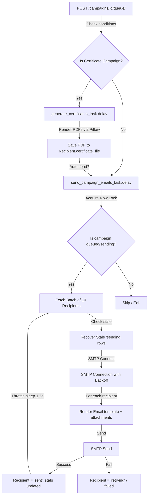

# Backend Architecture & Pipelines

This document details the backend business logic, asynchronous task design, security routines, and database constraints of EmailOPS.

---

## 1. Asynchronous Celery Pipelines

Background tasks are defined in [emails/tasks.py](file:///C:/Users/ASUS/Desktop/WorkTree/EmailOPS/emails/tasks.py) and [certificates/tasks.py](file:///C:/Users/ASUS/Desktop/WorkTree/EmailOPS/certificates/tasks.py). They handle high-concurrency or resource-intensive flows.



### A. Bulk Email Task (`send_campaign_emails_task`)
Initiates the bulk email sending queue:
- **Campaign State Guard**: Obtains a database row lock using `select_for_update()` to transition the campaign's status to `sending`. This prevents multiple Celery workers from claiming and processing the same campaign.
- **Batch Processing**: Fetches recipients in batches of 10 (`batch_size=10`). Pending or retrying recipients are claimed atomically by updating their status to `sending`.
- **Credential Decryption**: Decrypts the App Password using `cryptography.fernet`. If decryption fails, the campaign is flagged as `failed` and recipients are released.
- **SMTP Connection Retries**: Connects to the host using `get_connection`. A transient network failure initiates a retry loop with exponential backoff (base `1`s, doubling each attempt up to 4 attempts). Terminal authentication failures abort immediately.
- **Throttling**: Introduces a sleep delay (`throttle_delay=1.5`s) between individual email dispatches to prevent hitting rate limits (e.g., Gmail's daily limits).
- **Completion Detection**: Re-checks database records once a batch completes. If no pending, retrying, or sending recipients remain, the campaign status updates to `completed`.

### B. Stale Task Reaper (`reap_stale_sending_recipients_task`)
A periodic maintenance task designed to recover from unexpected worker crashes:
- If a Celery worker container dies mid-batch, claimed recipients remain stuck in the `sending` status, preventing the campaign from completing.
- The reaper scans for recipients stuck in `sending` for longer than 10 minutes (`STALE_SENDING_THRESHOLD`).
- Stuck rows are reset to `retrying` to allow other workers to process them. This reaper runs at the start of every email batch and as a periodic Celery Beat task.

### C. Certificate Task (`generate_certificates_task`)
Generates PDF files for a campaign's recipients in the background:
- For each recipient, it calls `save_certificate_for_recipient()` to render the PDF.
- If a recipient's generation fails, it logs the exception, updates their status to `failed`, and records the error message.
- If `auto_send=True` is specified, it queues `send_campaign_emails_task` upon completing the certificate generation.

---

## 2. Credentials Cryptography

SMTP App Passwords are encrypted before database insertion in [accounts/models.py](file:///C:/Users/ASUS/Desktop/WorkTree/EmailOPS/accounts/models.py#L52-L73).

```python
from cryptography.fernet import Fernet
from django.conf import settings

# Encryption
def set_app_password(self, raw_password):
    if not raw_password:
        raise ValueError("App password cannot be empty.")
    self.encrypted_password = self.decryptor.encrypt(raw_password.encode()).decode()

# Decryption
def get_app_password(self):
    if not self.encrypted_password:
        return ""
    try:
        return self.decryptor.decrypt(self.encrypted_password.encode()).decode()
    except Exception as e:
        logger.error(f"Error decrypting app password for {self.smtp_username}: {e}")
        return ""
```

- **Symmetric Standard**: Uses AES-128 in CBC mode with a SHA-256 HMAC for integrity checking via python's `cryptography` package.
- **Key Isolation**: The decryption key is loaded from the `SMTP_ENCRYPTION_KEY` environment variable. It is not committed to the source control repository.

---

## 3. Concurrency & Locking Guards

To ensure delivery statistics are accurate and prevent double-sending emails, EmailOPS enforces two strict concurrency guards:

1. **State Machine Locking**: A campaign must be in a state of `draft`, `failed`, or `cancelled` before editing or deletion is allowed. Once queued or sending, the campaign becomes immutable. This rule is enforced in views via transaction boundaries.
2. **SMTP Configuration Protections**: If a user attempts to edit or delete an SMTP configuration, the backend verifies whether it is referenced by any campaign currently in a `queued` or `sending` state. If found, the request is rejected with a validation error.
