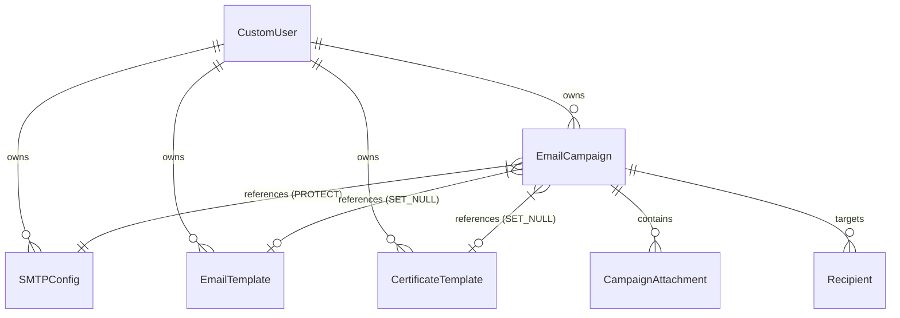

# Database Schema & Models

This document describes the schema architecture, relationships, model descriptions, soft-deletion layers, and file management signals.

---

## Entity-Relationship Diagram

The relationships between models are structured as follows:

---

## Model Reference

### 1. `CustomUser` (accounts app)
Extends Django's `AbstractUser` to authenticate users using their email address.
- **Fields**:
  - `email` (EmailField, unique=True, acts as login username).
  - `username` (CharField, automatically synchronized with `email`).

### 2. `SMTPConfig` (accounts app) - *Soft Deleted*
Stores SMTP server connection configurations.
- **Fields**:
  - `user` (ForeignKey -> CustomUser).
  - `name` (CharField, default='Gmail SMTP').
  - `smtp_host` (CharField, default='smtp.gmail.com').
  - `smtp_port` (IntegerField, default=587).
  - `smtp_username` (EmailField).
  - `encrypted_password` (TextField, stores Fernet-encrypted Gmail App Password).
  - `use_tls` (BooleanField, default=True).
  - `is_active` (BooleanField, default=True).

### 3. `EmailTemplate` (emails app) - *Soft Deleted*
Defines the layout design choices and structured copy variables.
- **Fields**:
  - `user` (ForeignKey -> CustomUser).
  - `name` (CharField).
  - `subject` (CharField, supports template merge tags).
  - `body_html` (TextField, rendered HTML output from the layouts builder).
  - `body_text` (TextField, plain text fallback).
  - `layout` (CharField, design key: `simple`, `announcement`, `newsletter`, `promotion`, `event`, `custom`).
  - `brand_color` (CharField, hex value).
  - `logo_url` (URLField).
  - `logo_size` (IntegerField).
  - `content` (JSONField, holds structured copy data).

### 4. `EmailCampaign` (emails app) - *Soft Deleted*
Represents an email dispatch workflow.
- **Fields**:
  - `user` (ForeignKey -> CustomUser).
  - `name` (CharField).
  - `template` (ForeignKey -> EmailTemplate, `on_delete=models.SET_NULL`).
  - `smtp_config` (ForeignKey -> SMTPConfig, `on_delete=models.PROTECT`).
  - `status` (CharField: `draft`, `queued`, `sending`, `completed`, `failed`, `cancelled`).
  - `total_emails` (IntegerField).
  - `sent_emails` (IntegerField).
  - `failed_emails` (IntegerField).
  - `is_certificate_campaign` (BooleanField).
  - `certificate_template` (ForeignKey -> CertificateTemplate, `on_delete=models.SET_NULL`).
  - `started_at` / `completed_at` (DateTimeField).

### 5. `CampaignAttachment` (emails app)
Tracks upload documents associated with campaign emails.
- **Fields**:
  - `campaign` (ForeignKey -> EmailCampaign, `on_delete=models.CASCADE`).
  - `file` (FileField, stored under `campaign_attachments/`).
  - `filename` (CharField).

### 6. `Recipient` (emails app)
Tracks the dispatch logs and individual open metrics for each recipient.
- **Fields**:
  - `campaign` (ForeignKey -> EmailCampaign, `on_delete=models.CASCADE`).
  - `email` (EmailField).
  - `name` (CharField).
  - `context_data` (JSONField, merge tags imported from CSV).
  - `status` (CharField: `pending`, `sending`, `sent`, `failed`, `retrying`).
  - `error_message` (TextField).
  - `sent_at` (DateTimeField).
  - `opened_at` (DateTimeField).
  - `tracking_uuid` (UUIDField, automatically generated for tracking pixel resolution).
  - `certificate_file` (FileField, stores the generated PDF).

### 7. `CertificateTemplate` (certificates app) - *Soft Deleted*
Stores coordinates alignment and configuration data for dynamic certificate drawings.
- **Fields**:
  - `user` (ForeignKey -> CustomUser).
  - `name` (CharField).
  - `image` (ImageField, template PNG/JPG background).
  - `x_start` / `x_end` (IntegerField, bounding box constraints).
  - `y_coordinate` (IntegerField, baseline height).
  - `font_size` (IntegerField).
  - `font_color` (CharField).
  - `font_file` (FileField, custom TrueType Font file uploads).

---

## Soft-Delete Implementation Invariant

To preserve historical accuracy, key entities must not be physically removed from the database during typical deletions. Instead, they inherit from `SoftDeleteModel` ([core/models.py](file:///C:/Users/ASUS/Desktop/WorkTree/EmailOPS/core/models.py)).

- **Model managers**:
  - `objects` (default): Unfiltered manager. Returns all records, including deleted ones. **Mandatory** for foreign-key integrity lookups, administrative review, and historical reporting.
  - `active` (custom): Excludes soft-deleted records (`deleted_at__isnull=True`). Used on public listings, dashboards, and select fields.
- **Database Fields**: Adds a `deleted_at` field (nullable DateTime).
- **Behavior**:
  - `delete()` on a soft-deleted model instance sets `deleted_at = timezone.now()` and saves the update.
  - `restore()` sets `deleted_at = None`.
  - `hard_delete()` physically removes the row from the database (admin only).

---

## Signal Handling (Physical File Cleanup)

Models with `FileField` or `ImageField` (e.g., `CampaignAttachment`, `Recipient`, `CertificateTemplate`) register pre-save and post-delete signals in their respective apps to automatically remove orphaned files from disk storage.

- **`post_delete` signal**: Triggers when a model row is deleted. It searches for all file fields on the model and deletes their associated physical files on disk.
- **`pre_save` signal**: Triggers before saving edits to a model row. If a file field has been updated with a new file, it detects the change, deletes the old file from disk, and writes the new one to prevent storage leaks.
