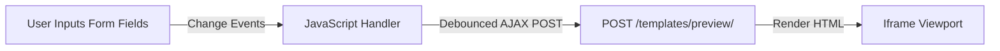

# Frontend Design & UI Flow

This document details the user interface guidelines, styling standards, live preview mechanics, and CSV parsing operations of the EmailOPS application.

---

## 1. Styling Standards & Theme Support

EmailOPS implements a responsive dashboard interface built on **Bootstrap 5** and custom CSS variables defined in [static/css/style.css](file:///C:/Users/ASUS/Desktop/WorkTree/EmailOPS/static/css/style.css).

### Light & Dark Mode Invariant
The UI supports both Light and Dark modes out-of-the-box. To maintain theme compatibility, the system prohibits hardcoded color values. Instead, developers must use Bootstrap's theme-aware classes:

- **Backgrounds**: Use `bg-body` or `bg-body-tertiary` (not `bg-white` or `bg-light`).
- **Typography**: Use `text-body` or `text-body-secondary` (not `text-dark` or `text-light`).
- **Borders**: Use `border-secondary` or `border-translucent`.

*Exception*: Yellow warning alerts (`text-bg-warning text-dark`) and brand asset logos (such as the Google identity sign-in icon) are permitted to override theme defaults to maintain contrast or brand consistency.

---

## 2. Interactive Template Builder & Previews

The email template creator uses a live builder interface split into a form control panel (left) and an iframe render view (right).



### Live Preview Workflow
1. **Change Input**: The user types template content, adjusts the brand color picker, or inputs logo URLs.
2. **Iframe Synchronization**: JavaScript collects form attributes and issues a debounced POST request to the `emails:template_preview` endpoint.
3. **Structured Rendering**: The view passes the content parameters to `email_designs.render()`, which places them into a responsive HTML table.
4. **Merge Tag Verification**: The server compiles this HTML output with sample template variables using Django's template engine. If a syntax error is detected, a warning bar is displayed above the output in the iframe.

```python
# emails/views.py
def _render_preview_with_django(html):
    try:
        t = Template(html)
        c = Context(_PREVIEW_SAMPLES)
        return t.render(c)
    except Exception as e:
        err_msg = f'<div class="error-bar">Template Syntax Error: {e}</div>'
        return err_msg + html
```

---

## 3. Certificate Coordinates Canvas Preview

When setting up certificate templates, users define naming alignment coordinates: `X Start`, `X End`, and `Y coordinate`. 

To assist configuration, the template detail page renders the base image inside a relative container. Dynamic HTML line overlays are positioned based on the database settings to preview the bounding box:

- **Horizontal Boundary**: Rendered as a dotted line stretching from `X Start` to `X End` at height `Y`.
- **Center Baseline Marker**: A vertical node indicating where name centering begins.

---

## 4. Normalizing CSV Imports

To support recipient lists exported from various platforms, the CSV importer in [emails/views.py](file:///C:/Users/ASUS/Desktop/WorkTree/EmailOPS/emails/views.py#L490) normalizes headers.

### Importer Rules
1. **UTF-8-SIG Decoding**: Decodes file streams using `utf-8-sig` to strip any Byte Order Marks (BOM) written by Microsoft Excel.
2. **Header Normalization**: Trims whitespace and converts column headers to lowercase.
3. **Auto-Detect Email**: Matches columns containing `email` or `mail` as the primary address column.
4. **Auto-Detect Name**: Matches columns containing `name`, `username`, or `participant` as the name column. Falls back to splitting the email prefix if no name column is found.
5. **Context Retention**: Any remaining columns are stored as a key-value dictionary in the recipient's `context_data` field. These custom variables can be referenced in email templates (e.g. `{{ company }}`, `{{ award_title }}`).
